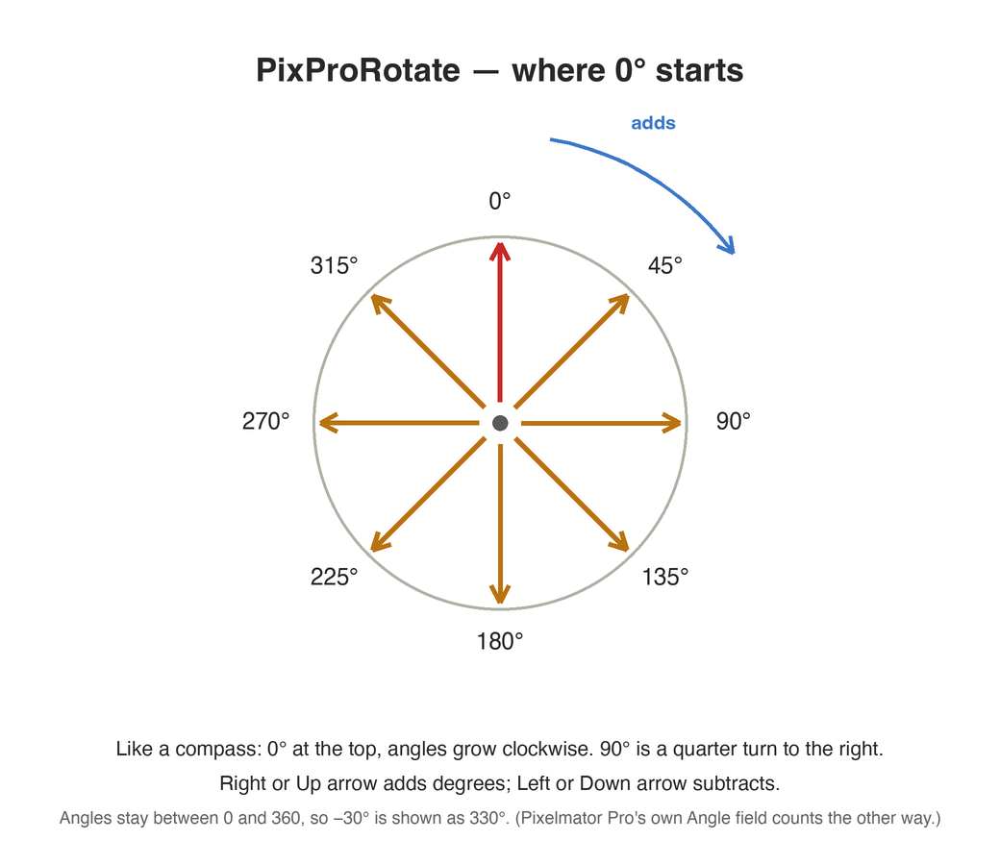

# PixProRotate 2.3.0

Rotates the selected Pixelmator Pro layers to any angle, positive or negative,
from the keyboard or by typing a number.

### [⬇︎ Download the latest release](https://github.com/spurious-cox/pixprorotate/releases/latest)

Notarized and stapled by Apple — open the DMG and drag PixProRotate to
Applications, or install it with Homebrew:

```
brew install --cask spurious-cox/tap/pixprorotate
```

Requires Pixelmator Pro and macOS 12 or later. Both the 3.x build and the
Creator Studio build work.

## Why this exists

Apple got rotation wrong in Pixelmator Pro. Its rotate control starts at 0 and
only turns positively, 0 to 360, so turning a layer a little the other way, or
walking it negatively from 360 down to 0, is slow and tedious. Its numbers also
count counterclockwise, the opposite of a compass and of how most people read an
angle.

PixProRotate fixes that: a small panel that turns the selection either
direction from the keyboard, takes a typed angle, and always shows the angle
it is at, counted like a compass.

## Where 0 starts



PixProRotate reads like a compass. 0 degrees is at the top, and angles grow
clockwise: 90 is a quarter turn to the right, 180 is upside down and 270 is a
quarter turn to the left. Right and Up add degrees; Left and Down subtract them.

Pixelmator Pro's own Angle field counts the other way (counterclockwise), so
the number PixProRotate shows is 360 minus the one in Pixelmator Pro's
inspector: a layer showing 30 here is 330 there. The layer itself turns the
same either way; only the numbering differs.

## Using it

Select one or more layers in Pixelmator Pro and open PixProRotate. The panel
opens at the top-right corner of the Pixelmator Pro window and floats above all
other windows until you press **Quit**. Pixelmator Pro keeps your selection. Number keys type straight into the angle box. With
Accessibility access (below) the arrow keys work without clicking the panel.

### Keyboard

* **Right arrow or Up arrow** — add 1 degree (turn clockwise)
* **Left arrow or Down arrow** — subtract 1 degree (turn counterclockwise)
* **Tap an arrow key** — exactly one step (1 degree)
* **Hold an arrow key** — after a brief pause it keeps turning, and turns faster the longer you hold, but **never more than 10 degrees in one press**; it stops there until you let go and press again. Always whole degrees except with Option
* **Shift + arrow** — faster, 3 degrees a step (still stops at 10 degrees a press)
* **Option + arrow** — fine, 0.1 degree a step
* **Number keys, keypad and decimal point** (0-9, `.`, and `-`) — type an angle into the angle box, even
  while Pixelmator Pro is the active app. The first digit starts a new number.
* **Return** or keypad **Enter** — set the angle you typed
* **Delete** — remove the last character you typed; **Escape** — cancel and show the current angle again
* **Command-Q** — quit

Right and up add, left and down subtract.

### Arrow keys while Pixelmator Pro is active

By default the arrow keys rotate the selection even when Pixelmator Pro is the
active app, where they would otherwise nudge the selected object. This needs
Accessibility access: the first time, macOS asks, or open System Settings >
Privacy & Security > Accessibility, switch PixProRotate on, then reopen it.
While you are typing in a text field or editing text in Pixelmator Pro the
arrows keep their normal job (moving the cursor), and Command or Control with
an arrow is left alone.

To get the normal nudging back, untick **Arrow keys: check to rotate, uncheck to
move** in the panel, or quit PixProRotate. Without Accessibility access the
arrow keys work only while the PixProRotate panel itself is the active window.

### The angle box

The box always shows the compass angle of the selected layer, such as 47 or 80,
and follows the selection as you change it in Pixelmator Pro. Type a number and
press Return to set the angle exactly. Negative numbers work: -80 gives 280,
because angles are kept between 0 and 360.

### Detect, Level and Restore

Pixelmator Pro reports a drawn diagonal line (or anything imported from SVG) as
rotation 0, because the angle is in its shape, not in a setting. Three buttons
deal with that, so you can edit an angled item straight and then put it back:

1. **Detect** measures the angle you can actually see. It copies the selected
   layer, finds the long axis of its pixels, and shows the result in the message
   line, with how far it is from straight. It does not change anything.
2. **Level** turns the layer to the nearest horizontal or vertical and
   remembers how far it turned. Now it is easy to edit.
3. **Restore** turns it back by exactly that amount; if the leveled item is no longer selected (you clicked inside the group, say) it tells you so instead of turning something else.

The button to press next is green: Detect, then Level, then Restore, then back
to Detect. Choosing a preset (0°, 90°, 180°, 270°) turns all the colors off until
you press Detect again. When nothing is selected, the round is abandoned: the
backup copy of a group is deleted and the saved starting angles are forgotten.

**Cancel** is the way out when changes get out of hand: it puts the selected
layer back to the angle it had when you selected it, whatever you did since
(arrow keys, typed angles, presets, Level, Restore). It lights up red whenever
the layer is no longer at that starting angle, and goes plain again once it is.
If you select a different layer, that layer's angle becomes the new starting
point.

**Groups are backed up.** Editing inside a group (a line turned into a curve,
items moved) changes more than its angle. So when you press Detect or Level on a
group, PixProRotate first makes a hidden copy of it right beside it, named
"PixProRotate backup". Cancel swaps the original back for that copy, whatever you
changed inside. Cancel also goes red when the group's size, position, rotation or
direct contents no longer match the copy. The copy is deleted when you start on a
different group, when nothing is selected, or when you quit PixProRotate; if you save the document in between, the
hidden copy is saved with it, so delete it by hand if you do not want it. Edits
that change nothing the copy can compare (for example a path reshaped inside the
same outline) do not turn Cancel red, but Cancel still restores them.

Detect and Level work on **one layer at a time**. A group counts as one layer,
so a line made of a shaft and an arrowhead is fine. If several layers are
selected, a dialog says so; select a single layer, or group the items first.
Round or square shapes have no clear direction, so Level leaves them alone. Your
clipboard is put back after each measurement, and the angle is accurate to a
fraction of a degree.

### Presets

The **0°**, **90°**, **180°** and **270°** buttons set the angle outright.

### Several layers

Every selected layer is turned by the same step, so they keep their relative
angles. The box shows the first selected layer's angle. The presets and typed
angles set every selected layer to the same angle. Detect and Level are the
exception: they need a single layer (see above).

## Permission

The first time, macOS asks whether PixProRotate may control Pixelmator Pro.
Allow it; that is how it reads and sets layer angles.

## Troubleshooting

* "No layer is selected" or "No document is open" appears under the angle box
  when Pixelmator Pro has nothing to rotate.
* "Select a single layer to measure" appears when Detect or Level is pressed
  with several layers selected.
* "The selection changed" under Cancel means the layers selected now are not the
  ones whose starting angle was saved; select the original layer again.
* "No clear direction" means the shape is nearly square or round, so it has no
  long axis to level.
* If the arrow keys still nudge the object, PixProRotate has no Accessibility access yet, or the
  checkbox in the panel is off.
* A log of launches, quits and every rotation (document, layer type, selection
  count, resulting angle) is kept at `~/Library/Logs/PixProRotate.log`. Attach it
  to an issue if something does not rotate.

## One version number

The app, its Get Info and this README all read **2.2.0**. `build.sh` takes the
number from `appVersion` in `main.swift` rather than keeping its own copy.

## Building

```
./build.sh --install
```

Compiles a universal (Apple silicon and Intel) binary from `main.swift`, adds
the icon (both the classic `.icns` and the macOS 26 Icon Composer icon), makes
the in-app Read Me from this file, signs with Developer ID and, with
`--install`, copies the app to `/Applications`. Signing with a fixed identity
matters here: macOS ties the Accessibility permission to the signature, and an
ad-hoc signature changes on every build, so the permission would be forgotten
each time.

## Problems or suggestions

Open an issue: https://github.com/spurious-cox/pixprorotate/issues

## Keep all the PixPro apps in one place

[Flache](https://github.com/spurious-cox/flache) is a floating dock for the apps you choose, shown and hidden with a hotkey. Make a PixPro panel in it and every PixPro app is one click away while you work in Pixelmator Pro.

## Trademarks

Pixelmator and Pixelmator Pro are trademarks of the Pixelmator Team Ltd. PixPro apps are independent and are not affiliated with, endorsed by or sponsored by Pixelmator or Apple.

## License

MIT. See LICENSE.
